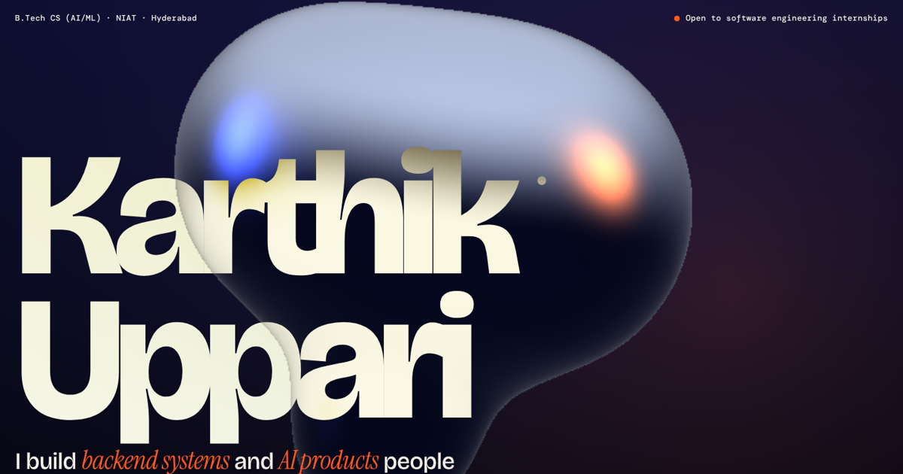

# Karthik Uppari — Portfolio



Personal portfolio of **Karthik Uppari**, a B.Tech CS (AI/ML) student at NIAT, Hyderabad, building backend systems and AI products. Open to software engineering internships.

## What's inside

- **Hero:** a real-time liquid-metal 3D shape (WebGL raymarching shader) that follows the cursor, with a static gradient fallback when WebGL is unavailable.
- **Selected work:** a pinned horizontal gallery with real screenshots and case-study overlays for CogniSpace, RecoverFlow, DocuMind, AgentGate and SpendLog.
- **Evidence:** animated charts of the measured results from each project, each with its caveat next to it.
- **Toolkit, Path, How I build, Contact:** skills, education and experience, working style, and ways to reach me.
- **⌘K / Ctrl+K command palette** for jumping around the site.
- **Accessibility and motion:** keyboard navigation, focus-trapped dialogs, a skip link, and full `prefers-reduced-motion` support.
- **Mobile layout:** the gallery stacks vertically and the header gets a frosted bar.

## Projects featured

| Project | What it is | Links |
| --- | --- | --- |
| CogniSpace | Notes, docs and a sprint board with an AI Copilot | [Code](https://github.com/karthik1122-code/cognispace) · [Live](https://cognispace-sigma.vercel.app) |
| RecoverFlow | Policy-first AI revenue recovery for failed Razorpay payments | [Code](https://github.com/karthik1122-code/recoverflow) · [Live](https://recoverflow-0qjg.onrender.com) |
| DocuMind | Evaluation-first question answering over the Express 5 docs | [Code](https://github.com/karthik1122-code/documind) · [Live](https://documind-opal-alpha.vercel.app) |
| AgentGate | Policy gate and approval runtime for AI agent tool calls | [Code](https://github.com/karthik1122-code/agentgate) · [Live](https://agentgate-lake.vercel.app) |
| SpendLog | Full-stack expense tracker with budgets, search and CSV export | [Code](https://github.com/karthik1122-code/spendlog) · [Live](https://spendlog-e525.onrender.com) |

## Tech

Plain HTML, CSS and JavaScript in a single file. No framework, no build step and no dependencies. Fonts load from Google Fonts.

## What is on the page

- A WebGL hero, scroll-driven gallery and manifesto, a ⌘K command palette, and smooth scrolling (Lenis, loaded from a CDN, off when reduced motion is requested).
- A case-study page for each project with the problem, the decision, the measured result, what I would do differently, an architecture diagram and a screen recording. Deep links like `#/work/agentgate` open them directly.
- An Evidence section with the real evaluation numbers and their caveats.
- A policy sandbox that runs AgentGate's own policy engine and argument checks in the browser against a simulated workspace. The engine code is copied from the AgentGate repo; nothing is executed.
- Reduced-motion and keyboard support. The only automated accessibility finding (axe-core) is the intentionally dimmed, not-yet-read words in the scroll-scrubbed About text.

## Project structure

```
index.html   the whole site (markup, styles, scripts)
og.png       social share image (1200×630)
assets/      project screenshots (WebP), short screen recordings of the apps (WebM and MP4), and the résumé PDF
```

## Run locally

```bash
python3 -m http.server 8000
# open http://localhost:8000
```

## Deploy

It is a static site, so any static host works. On Vercel, import the repo, choose the **Other** framework preset, leave build settings empty and deploy.

After deploying, update the site URL in `index.html` (`og:url`, canonical link, `og:image`, `twitter:image` and the JSON-LD `url`) to your real domain so link previews work.

## Contact

[upparikarthik505@gmail.com](mailto:upparikarthik505@gmail.com) · [GitHub](https://github.com/karthik1122-code) · [LinkedIn](https://linkedin.com/in/karthik-uppari-4005a7373)
